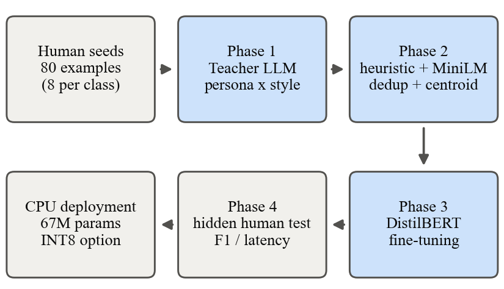

# Synthetic Data Generation Pipeline for Low-Compute Domain-Specific Text Classification

Minor Project (AIDS451), B.Tech. AI & DS, Dr. Akhilesh Das Gupta Institute of Professional Studies (GGSIPU), Delhi.
Supervisor: Mr. Ritesh Kumar.

A large language model (the **teacher**) turns **80 human-labelled examples** into a synthetic
training set. The set is filtered using sentence embeddings, and a small **student** model
(DistilBERT, 67M parameters) is fine-tuned on it so it can run on an ordinary CPU.

<p align="center"></p>

## Results
10 confusable Banking77 intents. Macro-F1 is measured on the official, hidden, human-labelled test set (400 queries).

| System | Macro-F1 | Latency / query |
|---|---|---|
| Teacher Qwen2.5-3B (4-bit), zero-shot, GPU | 0.823 | 523 ms |
| Teacher, few-shot (20 in-context examples), GPU | 0.872 | 705 ms |
| DistilBERT, 80 seeds only | 0.821 ± 0.021 | |
| **DistilBERT, seeds + filtered synthetic (proposed)** | **0.850 ± 0.004** | **22 ms CPU / 9.5 ms INT8** |
| MiniLM + logistic regression, 80 seeds only | 0.893 | 10 ms CPU |
| DistilBERT, all 1,351 real examples (upper bound) | 0.948 ± 0.006 | |

The student is statistically equal to the teacher (McNemar p > 0.2) and 24–55× faster on CPU.
Persona/style prompting was the most useful design choice. Filtering removed 45% of the data,
including all gibberish, without changing accuracy. A frozen-encoder baseline and a few real
examples remain stronger; the paper discusses both.

📄 Paper: [`paper/Synthetic_Data_Distillation_IEEE_Paper.pdf`](paper/Synthetic_Data_Distillation_IEEE_Paper.pdf)

## Repository layout
```
code/
  config.py              every setting (classes, models, thresholds, hyper-parameters)
  01_prepare_data.py     seed / test / oracle splits from Banking77
  02_generate.py         Phase 1: teacher prompting (persona x style)
  03_filter.py           Phase 2: heuristic -> MiniLM semantic dedup -> seed-centroid check
  04_teacher_eval.py     teacher zero-/few-shot baselines, latency, GPU memory
  05_train_students.py   Phase 3: 63 DistilBERT runs (main, ablations, scaling) + classical baselines
  06_benchmark.py        Phase 4: CPU latency / throughput / size (FP32, INT8)
  07_figures.py          figures for the paper
  08_stats.py            bootstrap CIs and McNemar tests
  pipeline/              teacher wrapper, filtering, student training
  tests/                 20 automated unit and integration tests (pytest)
  data/                  seeds, test set, raw and filtered synthetic data
  results/               JSON / CSV metrics, per-item predictions
  figures/               PNG figures
paper/
  build_paper.py         builds the IEEE-format paper (.docx -> .pdf via MS Word) from results/
```

## Reproduce
```bash
uv venv .venv --python 3.12
uv pip install --python .venv torch==2.5.1 --index-url https://download.pytorch.org/whl/cu124
uv pip install --python .venv -r code/requirements.txt
cd code
../.venv/Scripts/python 01_prepare_data.py     # use .venv/bin/python on Linux/macOS
../.venv/Scripts/python 02_generate.py
../.venv/Scripts/python 03_filter.py
../.venv/Scripts/python 04_teacher_eval.py
../.venv/Scripts/python 05_train_students.py
../.venv/Scripts/python 06_benchmark.py
../.venv/Scripts/python 07_figures.py
../.venv/Scripts/python 08_stats.py
../.venv/Scripts/python -m pytest tests -v   # 20 tests
```
Full run time is about 1 hour on an RTX 4050 Laptop GPU (6 GB). To use Llama-3 or Mistral through
Ollama, LM Studio, vLLM or Groq, set `TEACHER_BACKEND = "openai"` in `config.py`.
Building the paper (`paper/build_paper.py`) needs Microsoft Word on Windows for the PDF export.

## Licences
* Code: MIT (see `LICENSE`).
* Banking77 data: CC BY 4.0, Casanueva *et al.*, "Efficient Intent Detection with Dual Sentence Encoders", 2020.
* Synthetic data: generated with Qwen2.5-3B-Instruct (Qwen Research License), shared for non-commercial research use.
